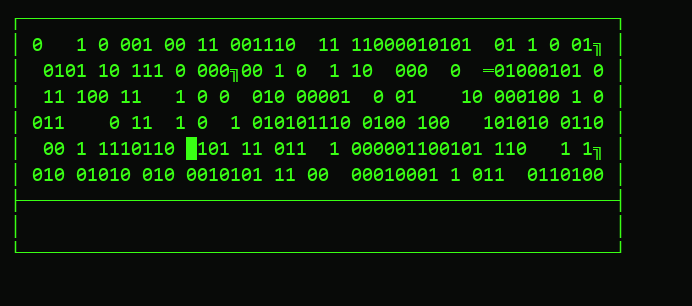
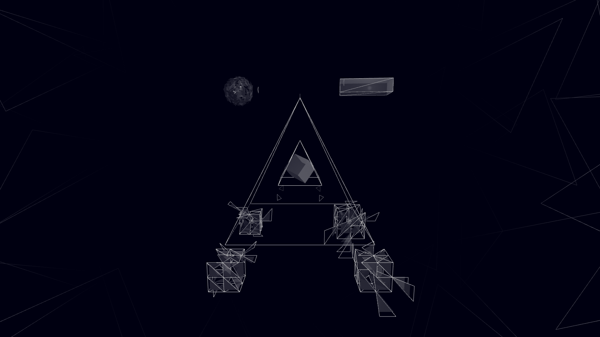
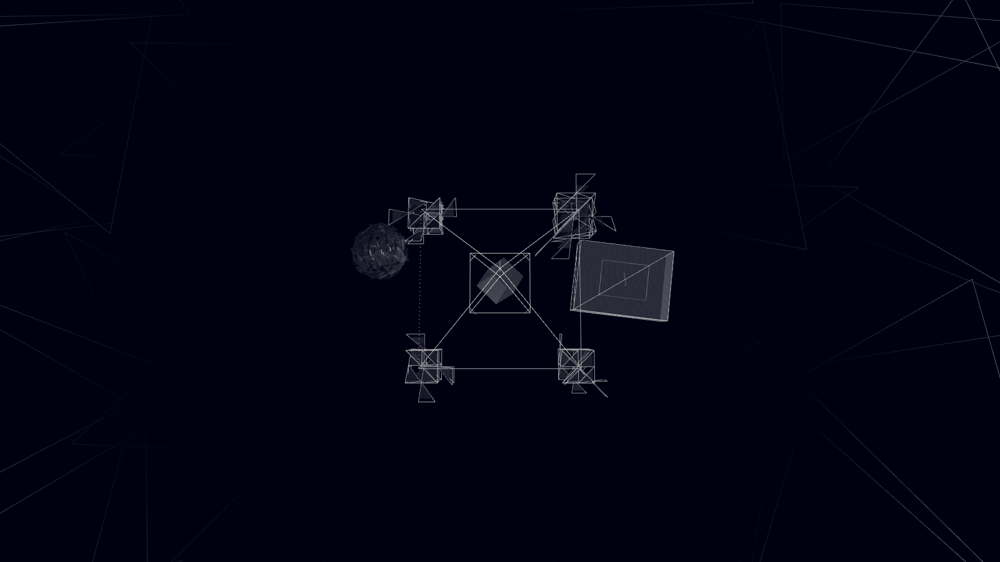
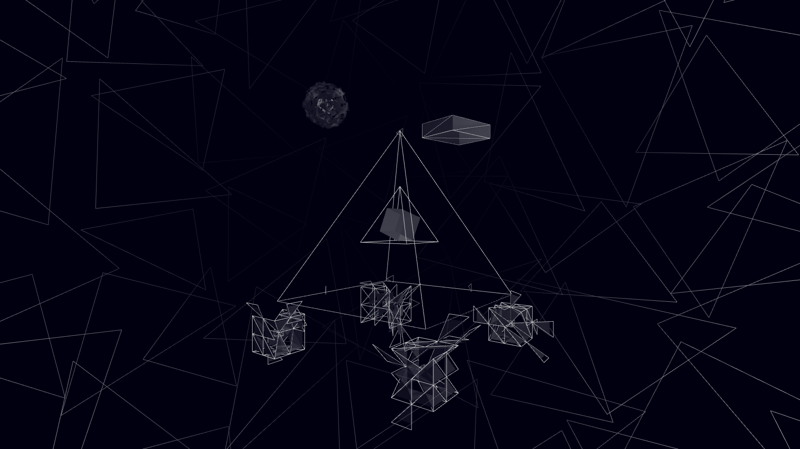

# Crucible Showcase

Two pieces of visual work salvaged from **Project Crucible v0.7** — a paused,
multi-agent AI framework built July–November 2025. Both were functional
artifacts of that project (a boot sequence, a live monitoring dashboard) that
ended up as small pieces of terminal/web art in their own right. Extracted
here on their own, decoupled from the rest of v0.7's backend.

## The pieces

### [`cortex-boot-sequence/`](cortex-boot-sequence/)
A three-part terminal animation for "Cortex" (the memory/reasoning module):
a green pixel-dissolve intro, a blue boot-up sequence, a red shutdown. Pure
Python, no dependencies beyond the standard library.



### [`architecture-dashboard/`](architecture-dashboard/)
A Three.js scene of the system's services rendered as glowing, translucent
"ice crystal" geometries floating in fog, with soft shadows and free
orbit/zoom. Originally one view inside a live 2D+3D monitoring dashboard;
only the 3D scene — the part that was pure spectacle — survived the cut.

**[▶ View it live](https://earlyprototype.github.io/crucible-demoscene/architecture-dashboard/)** — no install needed.

<p>
  
  
  
</p>

## Build and smoke check

Install Node.js 18 or later, Python 3.10 or later, and Google Chrome. Run
`npm ci` once from the repository root to install the locked dependencies.
Run the build and both smoke checks from the same directory.

```sh
npm run smoke
```

The command builds an offline dashboard in `dist/architecture-dashboard/`,
runs the scene tests, and plays all three Python entry points with a fixed
random seed, simulated Enter input, and no delays. Headless Chrome checks
pixels from the visible canvas and tests the mouse, keyboard, and HUD controls.
It checks that a three-pixel drag rotates the camera and keeps the current
focus. At close zoom, at maximum zoom-out in fog, and after panning up to a
wire, it samples the background around each test click and checks that the
target and focus label stay put. It also checks focus after a pan, all seven
crystals in the narrow view, and visible failure messages when the scene
script cannot load or WebGL cannot start. A failed check exits with an error.
Set `PYTHON` to the Python executable if needed. To use an installed Microsoft
Edge browser, set `SMOKE_BROWSER_CHANNEL` to `msedge`.

## Provenance

Both pulled from `components/cortex/` and `landing/` in the original v0.7
tree. No backend, orchestration, or other v0.7 machinery is required to run
either — that's the point of pulling them out.
