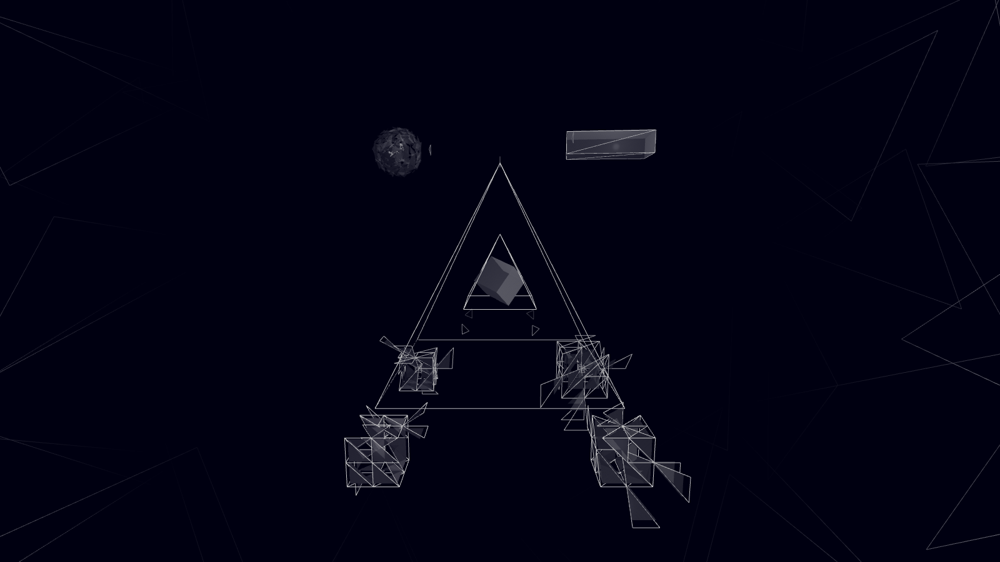
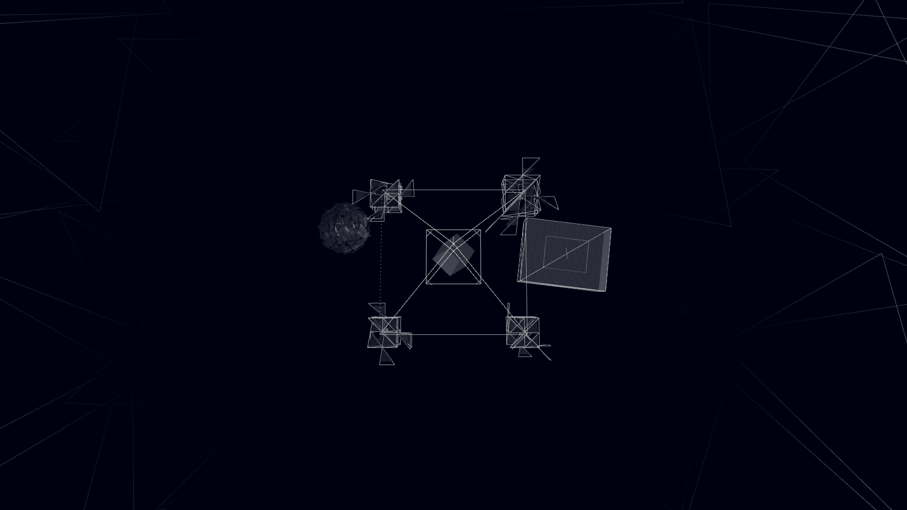
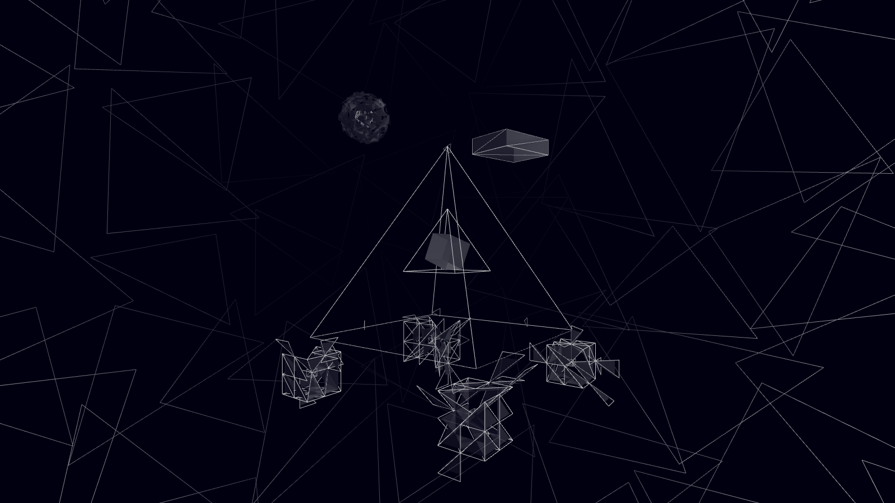

# Architecture Dashboard (3D)

Seven services appear as translucent crystals in a Three.js scene. Angled
facets catch a cool rim light, and wireframes trace each crystal through the
fog. The live page loads Three.js and OrbitControls from a CDN.

<p>
  
  
  
</p>

## Viewing it

**Live demo**

**<https://earlyprototype.github.io/crucible-demoscene/architecture-dashboard/>**

Drag to rotate and scroll to zoom. Click to focus on a service. The camera
follows an orbiting service until you choose another view. Clicking empty
space keeps the current target.

Use **Previous** (`[`) and **Next** (`]`) to cycle through the services.
**Reset view** (`Home`) restores the opening camera position and zoom.
The status above the scene changes to active after the first frame renders.
If a script or WebGL fails, the status shows the cause.

**Running it locally:**

1. Download the **whole repository** (green **Code** button → **Download ZIP**, then unzip) or `git clone` it. 
2. Open a terminal **inside the `architecture-dashboard/` folder** and start any static server:

   ```bash
   python -m http.server 8080
   ```

3. Open <http://localhost:8080> in your browser.

For a build with local copies of both libraries, follow the
[build and smoke check](../README.md#build-and-smoke-check).

## Original context

This was originally one of two views in a live ops dashboard that was stylised.
