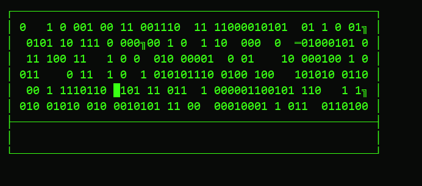

# Cortex Boot Sequence

A themed terminal animation trilogy for "Cortex," the memory/reasoning
module of Project Crucible v0.7. The animations and recorder use the Python
standard library.



## Play the trilogy offline

From the repository root, run this command with Python 3.10 or later.

```sh
python cortex-boot-sequence/record_replay.py
```

Open `cortex-replay.html` from the current directory in a browser. You can move
or rename that file. It contains the frames, styles and player and opens
directly from disk. To choose the output path, pass it as the last argument.

Select **Play** to watch Intro, Startup and Outro in order. **Pause** holds the
current frame. Choose a **Chapter** to jump to its first frame. Drag **Frame**
to scrub, or focus the slider and use the arrow keys to step one frame at a
time. Home and End seek to the ends of the chapter. Seeking pauses playback.
Play on the last frame of Outro restarts the trilogy.

The recorder runs each animation with seed 7 and an 80-column terminal.
Each sleep records the current output and advances simulated time. Identical
screens share a frame for the combined duration. The intro's final system
messages stay on screen for one second before Startup. Startup's last frame
includes its half-second hold. The terminal launch messages and Enter prompts
belong to the interactive scripts.

## Run the pieces in a terminal

From this directory, run any of the following in a terminal that supports
ANSI colours and Unicode box drawing.

```bash
python cortex_intro_animation.py
python cortex_startup_animation.py
python cortex_outro_animation.py
```

The intro dissolves binary noise into the green CORTEX logo, wipes the
remaining static and reveals “AI Knowledge Injection Protocol” word by word.
The blue startup sequence uses `░▒▓` shading behind READY, between
“INITIALIZING CORTEX FRAMEWORK” and “LLM NEURAL PATHWAYS ACTIVATING”.
The red outro reveals DEAD and types its closing line,
`>> TERMINATING CONNECTION <<`.

Each script builds a list of `(row, col, character)` for every non-space
pixel in the ASCII art, shuffles it, and reveals a batch per frame. The
remaining cells receive fresh noise on each redraw. The GIF above was made
by rendering the intro algorithm frame by frame into images.

## Regression checks

From the repository root, run the suite with the standard library test runner.

```sh
python -B -m unittest discover -s cortex-boot-sequence -v
```

The capture tests compare two recordings, check glyphs and ANSI colours sampled
from the terminal, and check frame timing and closing text. To include the
browser test, set `CORTEX_BROWSER` to a Chrome or Chromium executable and use
a Python environment with the `websockets.sync.client` module. The test moves
the generated file, disables networking in a fresh headless browser tab,
opens the file and exercises the controls.
